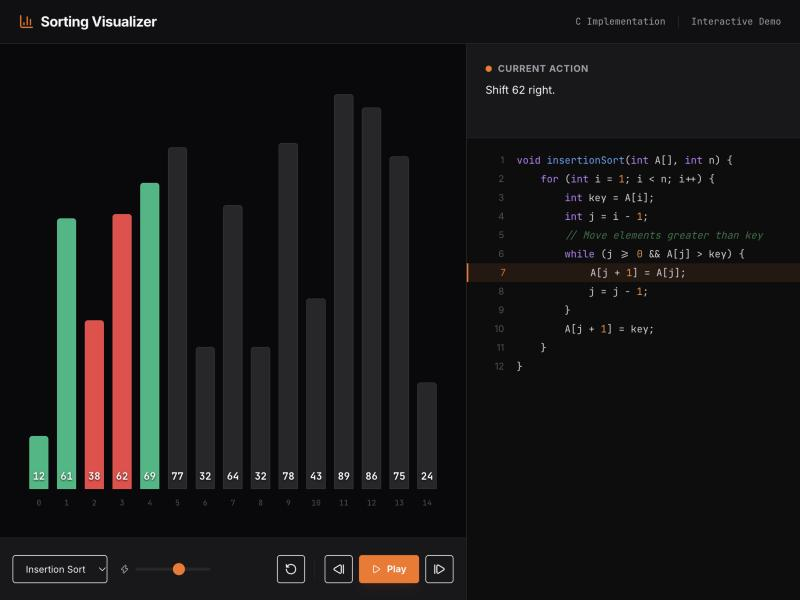

# Sorting Visualizer

Interactive explainer for classic sorting algorithms, built while learning C.
Step through Insertion, Selection and Bubble Sort and watch the array and the
matching line of C code side by side.

**Live demo:** https://mxwnklr.github.io/sorting_tool/



## Features

- Insertion, Selection and Bubble Sort on a random array of 15 values
- Highlights the line of C code that is currently running, with a plain-English explanation of each step
- Play / pause, adjustable speed, and step forward or backward through every comparison and swap
- Colour coding: blue = current key or minimum, orange = comparison, red = swap or shift, green = sorted

## How it works

Each algorithm is a JavaScript generator that mirrors the C code and yields a
snapshot at every step: array state, current C line, explanation and highlights.
The whole run is recorded as a timeline up front, which makes stepping backwards
trivial. Every bar keeps a stable id, so it animates to its new position on a swap
instead of being redrawn.

## Run locally

No build step. Open `index.html` in a browser, or serve the folder:

```bash
python3 -m http.server
```

## Tech

HTML, Tailwind CSS (CDN), vanilla JavaScript, Lucide icons.
